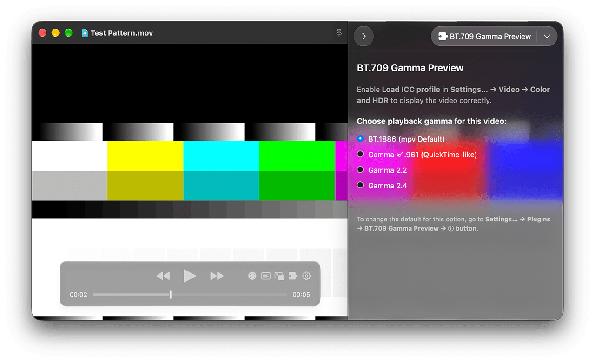

# BT.709 Gamma Preview

[English](#english) · [繁體中文](#繁體中文)

## English

Version `0.2.0` · Requires IINA `1.5.0` or later.

See how gamma changes the look of your video—without leaving IINA. Switch between BT.1886, QuickTime-like gamma ≈1.961, gamma 2.2, and gamma 2.4 during playback to compare contrast and preview different viewing environments.

### Required setting

Enable **Load ICC profile** in **Settings… → Video → Color and HDR** to display the video correctly.

### Using the plugin

Choose a playback gamma in **Menu Bar → Plugins → BT.709 Gamma Preview**. Choose **Show Details in Plugins Panel** to open the sidebar and access the plugin’s controls.

### Keyboard shortcuts

| Shortcut | Action |
| --- | --- |
| <kbd>⌃</kbd> <kbd>⌥</kbd> <kbd>0</kbd> | BT.1886 (mpv Default) |
| <kbd>⌃</kbd> <kbd>⌥</kbd> <kbd>1</kbd> | Gamma ≈1.961 (QuickTime-like) |
| <kbd>⌃</kbd> <kbd>⌥</kbd> <kbd>2</kbd> | Gamma 2.2 |
| <kbd>⌃</kbd> <kbd>⌥</kbd> <kbd>3</kbd> | Gamma 2.4 |
| <kbd>⌃</kbd> <kbd>⌥</kbd> <kbd>G</kbd> | Show Details in Plugins Panel |

### Default gamma and playback windows

Change the default playback gamma in **Settings… → Plugins → BT.709 Gamma Preview → ⓘ button**. The initial default is **BT.1886 (mpv default)**.

New playback windows use the default from the plugin’s settings. Each window has its own gamma selection and retains it when a new video is loaded in the same window.

### Supported video and preview limits

When IINA identifies a video as BT.709 (for example, a video with NCLC tags `1-1-1`), you can use this plugin to set its playback gamma. Some Log-encoded videos or videos without NCLC tags may also be identified as BT.709.

For unsupported video (such as HDR), the plugin applies no settings that change the video’s appearance and displays **Not applicable to this video**.

**QuickTime-like** is an approximate gamma preview, not an exact reproduction of QuickTime or ColorSync. Results depend on your display and playback configuration; this plugin does not calibrate your display.

### Required permissions

IINA requires **Access the file system** permission to adjust the video’s appearance through its API. However, this plugin **does not** read or write your files, execute external programs, or access the network.

---

## 繁體中文

版本 `0.2.0` · 需要 IINA `1.5.0` 或更新版本。

同一部影片，換個 gamma，對比外觀就不一樣。直接在 IINA 播放時切換 BT.1886、近似 QuickTime 的 gamma ≈1.961、gamma 2.2 與 gamma 2.4，輕鬆比較影片在不同觀看環境下的外觀。

### 必需設定

請於「**設定⋯ → 視訊 → 色彩和 HDR**」啟用「**載入 ICC 色彩描述檔**」選項，以正確呈現影片外觀。

### 使用外掛

在「**選單列 → 外掛程式 → BT.709 Gamma 預覽**」選擇播放 gamma。點選「**於外掛面板顯示詳細資訊**」將開啟側邊欄，並顯示外掛面板，提供更便捷的操作。

### 鍵盤快速鍵

| 快速鍵 | 動作 |
| --- | --- |
| <kbd>⌃</kbd> <kbd>⌥</kbd> <kbd>0</kbd> | BT.1886（mpv 預設） |
| <kbd>⌃</kbd> <kbd>⌥</kbd> <kbd>1</kbd> | Gamma ≈1.961（近似 QuickTime） |
| <kbd>⌃</kbd> <kbd>⌥</kbd> <kbd>2</kbd> | Gamma 2.2 |
| <kbd>⌃</kbd> <kbd>⌥</kbd> <kbd>3</kbd> | Gamma 2.4 |
| <kbd>⌃</kbd> <kbd>⌥</kbd> <kbd>G</kbd> | 於外掛面板顯示詳細資訊 |

### 預設 gamma 與播放視窗

你可以在「**設定⋯ → 外掛程式 → BT.709 Gamma 預覽 → ⓘ 按鈕**」更改預設的播放 gamma。初始預設為「**BT.1886（mpv 預設）**」。

新開啟的播放視窗將使用外掛設定內的預設值。每個播放視窗的 gamma 設定都是獨立的，同視窗載入新影片時也會保留選擇。

### 支援的影片與預覽限制

當 IINA 判定影片為 BT.709 時（例如 NCLC 標記為 `1-1-1` 的影片），你可以使用此外掛來設定播放 gamma。部分 Log 編碼、或 NCLC 未標記的影片可能也會被判定為 BT.709。

播放不支援的影片時（例如 HDR），外掛不會套用任何改變影片外觀的設定，並將提示**此影片不適用**。

**近似 QuickTime** 只提供近似的 gamma 預覽，並非完整重現 QuickTime 或 ColorSync。結果取決於螢幕與播放設定；此外掛不會校正螢幕。

### 權限需求

IINA 要求**存取檔案系統**權限，才能透過其 API 調整影片外觀；但此外掛**不會**讀寫你的檔案、執行外部程式或存取網路。

---

## License

[MIT License](LICENSE) · Copyright (c) 2026 babeneso
