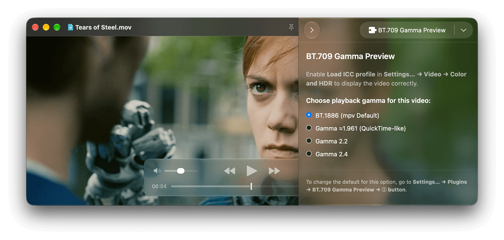
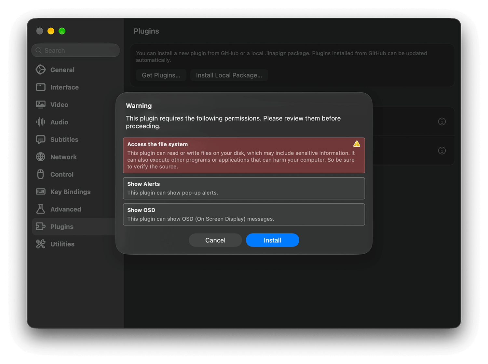

# BT.709 Gamma Preview

English · [繁體中文](README.zh.md)

Video: Tears of Steel, (CC) Blender Foundation | [mango.blender.org](https://mango.blender.org), licensed under [CC BY 3.0](https://creativecommons.org/licenses/by/3.0/).

Version `1.0.0` · Requires IINA `1.5.0` or later.

An IINA plugin that switches the playback gamma of BT.709 SDR video, so you can compare how the same video looks with different gammas without leaving the player.

It has four modes:

- **BT.1886 (mpv Default)**: IINA's normal playback.
- **Gamma ≈1.961 (QuickTime-like)**: close to how QuickTime Player shows BT.709 video on a Mac. It is an approximation, not an exact match.
- **Gamma 2.2**: typical of computer and phone screens in a normally lit room.
- **Gamma 2.4**: typical of TVs and grading monitors in a dim room.

## Install

In IINA, open **Settings… → Plugins**, click **Get Plugins…**, enter `babeneso/iina-bt709-gamma-preview`, and click **Install**. You can also get there from the menu bar: **Plugin → Manage Plugins…**.

IINA then warns that the plugin needs **Access the file system** permission. This is expected. The plugin needs it to adjust the gamma, but it doesn't read or write your files, run other programs, or connect to the internet. Click **Install** to continue.

## Before you start

Turn on **Load ICC profile** in **Settings… → Video → Color and HDR**. Without it, the modes won't display correctly. If it's off, the plugin reminds you once per window, but it never changes the setting for you.

## Switching gamma

Choose a mode from **Plugin → BT.709 Gamma Preview** in the menu bar, or use a keyboard shortcut:

| Shortcut | Action |
| --- | --- |
| <kbd>⌃</kbd> <kbd>⌥</kbd> <kbd>0</kbd> | BT.1886 (mpv Default) |
| <kbd>⌃</kbd> <kbd>⌥</kbd> <kbd>1</kbd> | Gamma ≈1.961 (QuickTime-like) |
| <kbd>⌃</kbd> <kbd>⌥</kbd> <kbd>2</kbd> | Gamma 2.2 |
| <kbd>⌃</kbd> <kbd>⌥</kbd> <kbd>3</kbd> | Gamma 2.4 |
| <kbd>⌃</kbd> <kbd>⌥</kbd> <kbd>G</kbd> | Show Details in Plugins Panel |

**Show Details in Plugins Panel** shows the same choices in IINA's sidebar.

## Default mode

New windows start in **BT.1886 (mpv Default)**. To change this, go to **Settings… → Plugins → BT.709 Gamma Preview** and click the **ⓘ** button. Each window keeps its own mode, even when you open another video in it.

## Which videos it works with

The plugin works with video that IINA identifies as BT.709 SDR. Videos without color information, including some Log footage, may also be identified as BT.709. For other video, such as HDR, the plugin changes nothing and shows **Not Applicable to This Video**.

## Good to know

- The plugin only changes how IINA displays the video. It doesn't modify your files, and it doesn't calibrate your display.
- What you see also depends on your display. A Mac's built-in display with its default display preset already shows color well, and Macs with an XDR display are even more accurate. With an external display, results depend on how that display is calibrated.

## License

[MIT License](LICENSE) · Copyright (c) 2026 babeneso
