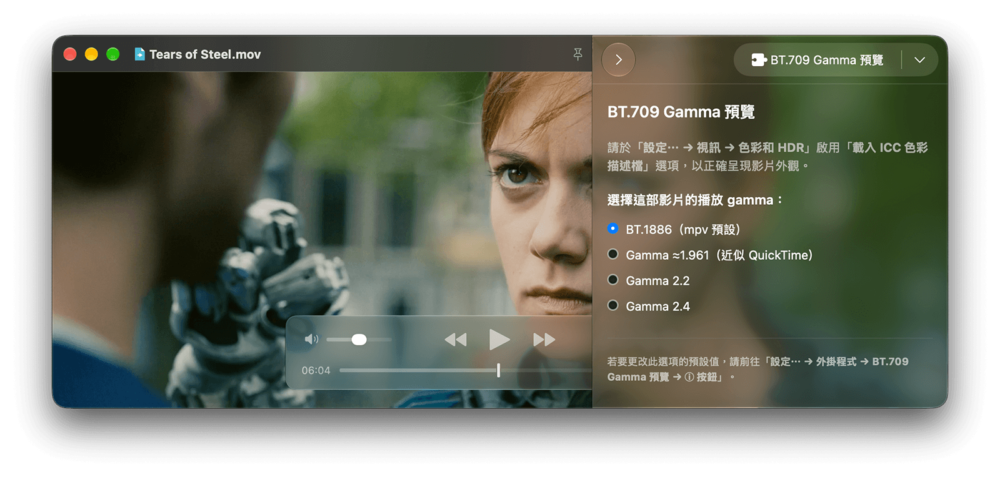
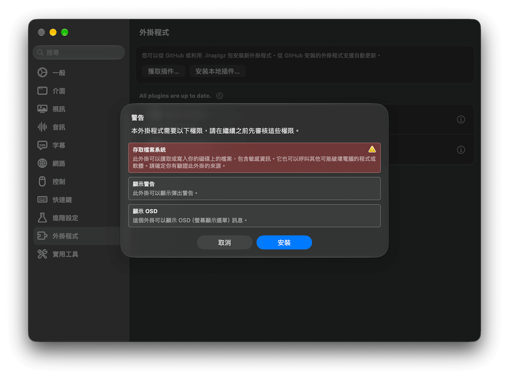

# BT.709 Gamma 預覽

[English](README.md) · 繁體中文

影片：Tears of Steel，(CC) Blender Foundation | [mango.blender.org](https://mango.blender.org)，以 [CC BY 3.0](https://creativecommons.org/licenses/by/3.0/deed.zh-hant) 授權。

版本 `1.0.0` · 需要 IINA `1.5.0` 或更新版本。

在 IINA 播放 BT.709 SDR 影片時，用來切換播放 gamma 的外掛。不必離開播放器，就能比較同一部影片在不同 gamma 下的樣子。

共有四種模式：

- **BT.1886（mpv 預設）**：IINA 原本的播放方式。
- **Gamma ≈1.961（近似 QuickTime）**：接近 QuickTime Player 在 Mac 上顯示 BT.709 影片的樣子。這是近似的效果，並非完全一致。
- **Gamma 2.2**：一般室內光線下，電腦與手機螢幕常見的顯示方式。
- **Gamma 2.4**：昏暗環境中，電視與調色螢幕常見的顯示方式。

## 安裝

在 IINA 開啟「**設定⋯ → 外掛程式**」，點「**獲取插件…**」，輸入 `babeneso/iina-bt709-gamma-preview` 後點「**安裝**」。也可以從選單列的「**外掛程式 → 管理外掛……**」進入同一個畫面。

接著 IINA 會警告這個外掛需要「**存取檔案系統**」權限，這是正常的。外掛調整 gamma 時需要這個權限，但不會讀寫你的檔案、執行其他程式或連上網路。點「**安裝**」即可繼續。

## 使用之前

請在「**設定⋯ → 視訊 → 色彩和 HDR**」開啟「**載入 ICC 色彩描述檔**」，否則各模式無法正確顯示。這個選項沒有開啟時，外掛會在每個視窗提醒一次，但不會替你更改設定。

## 切換 gamma

在選單列的「**外掛程式 → BT.709 Gamma 預覽**」選擇模式，或使用快速鍵：

| 快速鍵 | 動作 |
| --- | --- |
| <kbd>⌃</kbd> <kbd>⌥</kbd> <kbd>0</kbd> | BT.1886（mpv 預設） |
| <kbd>⌃</kbd> <kbd>⌥</kbd> <kbd>1</kbd> | Gamma ≈1.961（近似 QuickTime） |
| <kbd>⌃</kbd> <kbd>⌥</kbd> <kbd>2</kbd> | Gamma 2.2 |
| <kbd>⌃</kbd> <kbd>⌥</kbd> <kbd>3</kbd> | Gamma 2.4 |
| <kbd>⌃</kbd> <kbd>⌥</kbd> <kbd>G</kbd> | 於外掛面板顯示詳細資訊 |

點「**於外掛面板顯示詳細資訊**」，可以在 IINA 的側邊欄看到同樣的選項。

## 預設模式

新開的視窗預設使用「**BT.1886（mpv 預設）**」。要更改預設值，請到「**設定⋯ → 外掛程式 → BT.709 Gamma 預覽**」，點 **ⓘ** 按鈕。每個視窗各自記住自己的模式，在同一個視窗開啟其他影片時也不會改變。

## 適用的影片

外掛適用於 IINA 判定為 BT.709 SDR 的影片。沒有色彩資訊的影片，包括部分 Log 素材，也可能被判定為 BT.709。其他影片（例如 HDR）外掛不做任何調整，並顯示「**此影片不適用**」。

## 其他須知

- 外掛只改變 IINA 顯示影片的方式，不會修改你的檔案，也不是螢幕校色工具。
- 實際看到的效果也取決於螢幕。Mac 內建螢幕使用預設的「色彩描述」，就有不錯的色彩還原；配備 XDR 顯示器的 Mac 則更加精準。外接螢幕的效果，取決於該螢幕的校色狀況。

## 授權

[MIT License](LICENSE) · Copyright (c) 2026 babeneso
